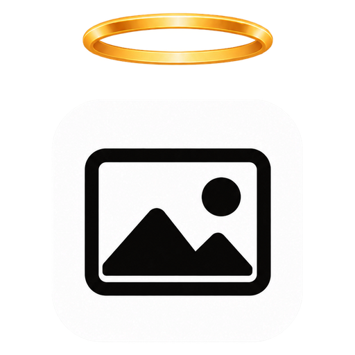
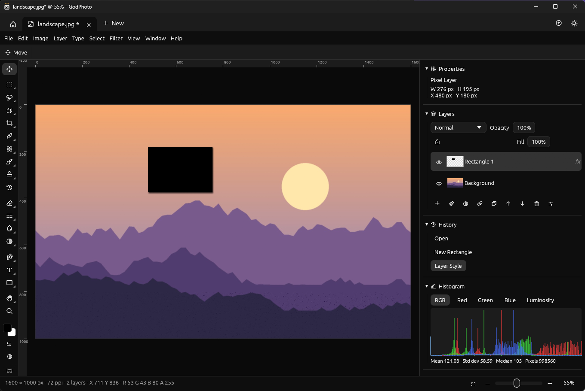

<p align="center"></p>

<h1 align="center">GodPhoto</h1>
<p align="center">A photo editor in pure Rust. Local: no account, no cloud.</p>

<p align="center"></p>

## Download

Windows: get `GodPhoto-windows-x64.exe` from the [latest release](https://github.com/0XLUC4/GodPhoto/releases/latest).
It is a single file, nothing to install. It is not signed, so Windows SmartScreen may ask before running it.
Linux and macOS builds are attached to each release too.
New versions come through the Updates button: it downloads one and restarts on it.

## Features

- **Menus** File, Edit, Image, Layer, Type, Select, Filter, View, Window, Help, with submenus and the shortcut of each command; a command palette (Ctrl+Shift+P) finds any of them by name.
- **66 tools** in a toolbar of groups (right-click a tool for the others of its group, Shift+key walks through them): Move, Artboard, Rectangular, Elliptical, Single Row and Single Column Marquee, Lasso, Polygonal Lasso, Magnetic Lasso, Object Selection, Quick Selection, Magic Wand, Crop, Perspective Crop, Slice, Slice Select, Eyedropper, Color Sampler, Ruler, Note, Count, Spot Healing Brush, Healing Brush, Remove, Patch, Content-Aware Move, Red Eye, Brush, Pencil, Color Replacement, Mixer Brush, Clone Stamp, Pattern Stamp, History Brush, Eraser, Background Eraser, Magic Eraser, Gradient, Paint Bucket, Blur, Sharpen, Smudge, Dodge, Burn, Sponge, Pen, Freeform Pen, Curvature Pen, Add, Delete and Convert Anchor Point, Path Selection, Direct Selection, Horizontal and Vertical Type, Horizontal and Vertical Type Mask, Rectangle, Ellipse, Triangle, Polygon (and stars), Line, Custom Shape, Hand, Rotate View, Zoom.
- **Brush engine**: size, hardness, opacity, flow, spacing, angle, roundness, scatter, size and hue jitter, smoothing, wet edges, build-up, pen pressure for size and opacity; brush presets, and brushes defined from a selection; painting stays inside the selection.
- **Layers**: pixel, type, shape (vector, edited point by point), smart object, solid color, gradient and pattern fill, and adjustment layers; groups that open and close, pass through or blend as one; artboards; 27 blend modes, opacity and fill, layer masks to paint on, masks from a path, clipping masks, locks, links, color labels, several layers picked at once (Ctrl / Shift), drag and drop to reorder, a filter by kind or name, merge down, merge visible, flatten, rasterize, layer via copy and cut, arrange, align, thumbnails.
- **Smart objects**: convert layers or place a file (File › Place Embedded); scale, turn and distort them without losing anything; edit their contents in a tab of their own, the smart object follows; replace their contents; filters on them stay smart filters, to turn off, change or delete at any time.
- **Paths**: the Pen, Curvature Pen and Freeform Pen draw paths; anchors are added, deleted, converted and moved with their handles; paths become selections, fills, strokes, shape layers or masks, and selections become paths; a Paths panel keeps them.
- **Color**: RGB, Grayscale, Indexed, Bitmap, CMYK and Lab modes; ICC profiles read from and written into files, assigned or converted to (four intents, black point compensation), built-in profiles (sRGB, Display P3, wide-gamut RGB, ROMM, Rec. 2020, gray, CMYK); soft proofing (Ctrl+Y) and gamut warning (Ctrl+Shift+Y).
- **16 adjustments**, as live adjustment layers or applied to pixels: Brightness/Contrast, Levels (with its histogram), Curves (points to drag, per channel), Exposure, Vibrance, Hue/Saturation, Color Balance, Black & White, Photo Filter, Channel Mixer, Invert, Posterize, Threshold, Gradient Map, Selective Color, Color Lookup (`.cube`). Also Shadows/Highlights, HDR Toning, Match Color, Replace Color, Desaturate, Equalize, Auto Tone, Auto Contrast and Auto Color.
- **Layer styles**: Drop Shadow, Inner Shadow, Outer and Inner Glow, Bevel & Emboss, Satin, Stroke, Color, Gradient and Pattern Overlay; copy, paste and clear them.
- **57 filters**, each previewed on the canvas while its dialog is open: blurs (Gaussian, Box, Motion, Radial, Surface, Smart, Lens, Tilt-Shift, Iris), sharpening (Sharpen, Sharpen More, Sharpen Edges, Unsharp Mask, Smart Sharpen), noise (Add Noise, Median, Reduce Noise, Despeckle, Dust & Scratches), distortions (Twirl, Pinch, Spherize, Wave, Ripple, Zig Zag, Polar Coordinates, Shear, Displace), Pixelate (Mosaic, Crystallize, Pointillize, Color Halftone, Mezzotint, Fragment, Facet), Stylize (Emboss, Find Edges, Glowing Edges, Solarize, Trace Contour, Wind, Extrude, Tiles, Diffuse, Oil Paint), Render (Clouds, Difference Clouds, Fibers, Lens Flare, Lighting Effects), High Pass, Maximum, Minimum, Offset, Vignette, Lens Correction, Custom kernel.
- **Selections**: add, subtract, intersect (or Shift / Alt), feather, Select Subject, Color Range, Select and Mask, border, smooth, expand, contract, grow, similar, inverse, reselect, Quick Mask (Q), saved selections as channels.
- **Free Transform** (Ctrl+T): move, scale, rotate, Ctrl+corner to distort and give perspective, on the picked, grouped and linked layers together; shapes, type, gradients and smart objects stay live; Transform Again (Ctrl+Shift+T); rotations and flips of a layer or of the canvas, any angle too.
- **Image**: Image Size with four resampling methods, Canvas Size with an anchor, crop to the selection, trim, grayscale.
- **Edit**: cut, copy, copy merged, paste, paste in place, paste into, through the system clipboard; fill with a color, a pattern or by content-aware fill; stroke; define a pattern.
- **History** of every step (Ctrl+Z / Ctrl+Shift+Z, or click a step), sharing memory between steps.
- **Actions**: record commands, play them on another image.
- **Panels**: Properties, Layers, Channels, History, Histogram (mean, standard deviation, median), Info (colors under the pointer and at the samplers, notes, count), Navigator, Color and swatches, Actions.
- **View**: zoom from 1% to 6400% at the pointer, pan, rotate the view, rulers, guides dragged from the rulers, grid, snapping, pixel grid, marching ants, full screen.
- **Files**: GodPhoto's own `.gphoto` (everything kept: groups, smart objects, shapes, styles, type, adjustments, profile, slices), PSD and PSB (layers, groups, masks, blend modes, clipping, color labels, ICC profile, RGB, Grayscale, CMYK and Lab), OpenRaster `.ora` with groups, Krita `.kra` and Paint.NET `.pdn` (open), SVG (opens as shape layers), FITS, and PNG, JPEG (also CMYK), BMP, GIF, TIFF (also CMYK), WebP, TGA, ICO, QOI, PNM, HDR, OpenEXR, AVIF (save). Export As with format, quality, scale and an estimate of the size; Quick Export to PNG; PDF; artboards and slices to files.
- **Printing** through the print dialog of Windows at the image's print size; on macOS and Linux the image opens as a PDF to print.
- Several images in tabs, home screen with recent images, dark and light theme, size of the interface.

Not there yet: 16 and 32 bits per channel (images are edited at 8 bits per channel; deeper files are read and brought to 8 bits), HEIC photos, warp transform, the frame tool.

## Build

```
cargo run --release
cargo test --workspace
```

Layout: `crates/core` (layers, blend modes, adjustments, filters, selections, painting, transforms, files), `crates/app` (egui app).

## License

MIT OR Apache-2.0
